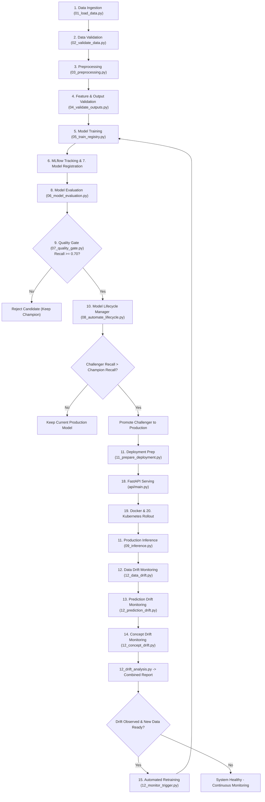

# Telco Customer Churn Prediction — End-to-End MLOps Platform

[](https://github.com/shaikanees7/churn_prediction/actions/workflows/python-ci.yml)

An enterprise-grade, end-to-end Machine Learning Operations (MLOps) system for predicting customer churn on the **Telco Customer Churn** dataset. The platform spans the complete machine learning lifecycle: data ingestion with SHA-256 lineage tracking, schema validation via Pandera, reproducible preprocessing with Scikit-learn pipelines, MLflow experiment tracking & model registry, automated model evaluation, strict quality gates, champion/challenger lifecycle promotion, FastAPI containerized serving, Kubernetes deployment, data/prediction/concept drift monitoring, and automated retraining triggers.

---

## Table of Contents
1. [Project Overview & Problem Statement](#project-overview--problem-statement)
2. [Technologies Used](#technologies-used)
3. [Project Architecture](#project-architecture)
4. [Complete Folder Structure](#complete-folder-structure)
5. [MLOps Lifecycle Workflow](#mlops-lifecycle-workflow)
6. [Key Python Files & Their Roles](#key-python-files--their-roles)
7. [Installation & Setup](#installation--setup)
8. [How to Run the Project](#how-to-run-the-project)
   - [Running Lab Pipelines](#running-lab-pipelines)
   - [Starting MLflow UI](#starting-mlflow-ui)
   - [Running the FastAPI Prediction API](#running-the-fastapi-prediction-api)
   - [Running the Docker Container](#running-the-docker-container)
   - [Deploying to Kubernetes](#deploying-to-kubernetes)
   - [Executing Automated Drift & Retraining Workflows](#executing-automated-drift--retraining-workflows)
   - [Running the Test Suites](#running-the-test-suites)
9. [GitHub Actions CI](#github-actions-ci)
10. [Reference Results & Metrics](#reference-results--metrics)

---

## Project Overview & Problem Statement

### The Problem
Customer churn is a critical metric for telecommunications providers. Acquiring new customers is substantially more expensive than retaining existing ones. Identifying customers at high risk of churning enables targeted retention campaigns, customized discounts, and proactive customer support.

### The Solution
Instead of a static script or ad-hoc notebook, this project provides a production-ready, automated MLOps platform:
- **Recall-First Philosophy**: In churn prediction, a False Negative (missing a churner who leaves) is far more costly than a False Positive (sending a discount to someone who stays). The platform enforces Recall (>= 0.70) as its primary decision and promotion metric.
- **Controlled Lifecycle**: Models are not automatically deployed. A newly trained challenger model must pass the quality gate and outperform the active champion model on holdout evaluation data before being promoted to `Production`.
- **End-to-End Monitoring**: Automatically detects Data Drift (KS tests, JS divergence), Prediction Drift (probability distribution shifts), and Concept Drift (performance degradation) on evolved production traffic, triggering automated retraining pipelines.

---

## Technologies Used

| Category | Tools & Libraries |
|---|---|
| **Language & Core** | Python 3.12, NumPy, Pandas |
| **Machine Learning** | Scikit-learn (RandomForest, DecisionTree, Pipelines, ColumnTransformer), XGBoost, Joblib |
| **Validation & Schema** | Pandera (DataFrame schemas, type enforcement, constraint checks) |
| **Experiment Tracking & Registry** | MLflow 3.x (SQLite backend store, artifact storage, Model Registry) |
| **API & Serving** | FastAPI, Uvicorn, Pydantic v2, Starlette |
| **Containerization & Orchestration** | Docker, Kubernetes (Deployments, NodePort Services) |
| **CI/CD & Automation** | GitHub Actions (CI pipelines, failure tests, scheduled monitoring triggers) |
| **Testing** | Pytest, Starlette TestClient, HTTPX |
| **Visualization** | Matplotlib, Seaborn |

---

## Project Architecture

```
+-----------------------------------------------------------------------------------+
|                              DATA INGESTION & VALIDATION                          |
|  Raw Data (churn.csv) + New Batches -> Pandera Schema Validation -> SHA-256 Check |
+-----------------------------------------------------------------------------------+
                                         |
                                         v
+-----------------------------------------------------------------------------------+
|                             FEATURE PREPROCESSING PIPELINE                        |
|   Numeric: Median Imputation + StandardScaler | Categorical: OneHotEncoder (OHE)  |
|   Fixed Test Partitioning (test_customer_ids.csv) to guarantee no data leakage   |
+-----------------------------------------------------------------------------------+
                                         |
                                         v
+-----------------------------------------------------------------------------------+
|                        TRAINING & MLFLOW EXPERIMENT TRACKING                      |
|   RandomForestClassifier (CloudPickle) -> SQLite MLflow Backend Store             |
|   Logs: Parameters, Metrics (Accuracy, Recall, F1, ROC-AUC), ROC/Confusion Plots |
+-----------------------------------------------------------------------------------+
                                         |
                                         v
+-----------------------------------------------------------------------------------+
|                        QUALITY GATE & MODEL REGISTRY DECISION                     |
|   Gate Check: Recall >= 0.70? -> Promote to Staging -> Compare Champion vs Chal. |
|   Promotion: If Recall(Challenger) > Recall(Champion) -> Promote to Production    |
+-----------------------------------------------------------------------------------+
                                         |
                                         v
+-----------------------------------------------------------------------------------+
|                         DEPLOYMENT BUNDLE & API SERVING                           |
|   deploy_if_promoted.py -> deployment/ (model.pkl, preprocessor.pkl, metadata)    |
|   FastAPI App (api/main.py) -> /predict, /predict/batch, /health, /metadata       |
|   Docker Container (churn-prediction-api) -> Kubernetes (k8s/deployment.yaml)     |
+-----------------------------------------------------------------------------------+
                                         |
                                         v
+-----------------------------------------------------------------------------------+
|                         CONTINUOUS DRIFT MONITORING & RETRAINING                  |
|   12_data_drift.py (KS / JS tests) + 12_prediction_drift.py + 12_concept_drift.py |
|   12_drift_analysis.py -> If Drift Detected -> 12_monitor_trigger.py Retraining   |
+-----------------------------------------------------------------------------------+
```

---

## Complete Folder Structure

```
churn-prediction/
├── .github/
│   └── workflows/
│       ├── lab8_ci.yml                   # CI pipeline: syntax, imports, pipeline execution, evidence check
│       ├── lab9_failure_tests.yml        # CI pipeline: simulated corruptions & failure recovery tests
│       ├── lab13_monitoring.yml          # Scheduled/triggered end-to-end drift monitoring workflow
│       └── lab13_runner_test.yml         # Diagnostic workflow for self-hosted runner environment
├── api/
│   ├── __init__.py                       # Package initialization
│   ├── main.py                           # FastAPI inference application with lifespan model loading
│   ├── model_loader.py                   # Loads verified model + preprocessor from deployment/ bundle
│   ├── monitoring_logger.py              # Thread-safe JSONL inference event logger
│   ├── preprocessing.py                  # API-level input sanitization and cleaning
│   ├── schemas.py                        # Pydantic v2 schemas for single & batch prediction requests
│   ├── stage9_flow.txt                   # Reference notes for deployment stage flow
│   └── stages.txt                        # API serving architecture documentation
├── artifacts/
│   ├── api_performance_report.json      # API latency and throughput benchmarks
│   ├── api_test_report.json             # Endpoint validation test execution evidence
│   ├── baseline_validation.csv          # Pandera schema failure logs during simulations
│   ├── confusion_matrix.png             # Confusion matrix plot from evaluation
│   ├── corrupted_simulation_errors.csv  # Simulation error logs
│   ├── data_load_report.json            # Lineage, hash, and row count of ingested data
│   ├── failure_simulation_report.json   # Simulation recovery report
│   ├── new_data_validation.csv          # Validation results on incoming batches
│   ├── pipeline_reproducibility_report.json
│   ├── preprocessing_summary_report.json
│   ├── production_model_report.json     # Details of active production model
│   ├── reproducibility_report.json
│   └── roc_curve.png                    # ROC curve visualization artifact
├── data/
│   ├── monitoring/
│   │   └── drift/
│   │       ├── evolved_data.csv         # Drifted feature dataset (traffic shift)
│   │       ├── evolved_labeled_data.csv # Drifted dataset with true labels for concept drift
│   │       └── post_drift_training_data.csv # Retraining dataset reflecting drifted patterns
│   ├── processed/
│   │   ├── dataset_metadata.json        # Preprocessing metadata, feature names, and split sizes
│   │   ├── test_customer_ids.csv        # Fixed 20% holdout test IDs (prevents data leakage)
│   │   ├── updated_training_data.csv    # Updated training records
│   │   ├── X_test_final.npy             # Transformed test features (NumPy array)
│   │   ├── X_test_raw.csv               # Raw test slice for evaluation and drift analysis
│   │   ├── X_train_final.npy            # Transformed training features (NumPy array)
│   │   ├── X_train_raw.csv              # Raw train slice
│   │   ├── y_test.npy                   # Test targets
│   │   └── y_train.npy                  # Train targets
│   └── raw/
│       ├── archive/
│       │   ├── churn_v01.csv            # Archived historical batch 1
│       │   ├── churn_v02.csv            # Archived historical batch 2
│       │   ├── churn_v03.csv            # Archived historical batch 3
│       │   └── dataset_lineage.json     # Cryptographic hash audit log
│       ├── churn.csv                    # Active training dataset (7,344 rows)
│       └── new_churn.csv                # Incoming customer batch for validation and drift
├── deployment/
│   ├── deploy_production.py             # Docker build and Kubernetes deployment automation
│   ├── model.pkl                        # Verified active Production model artifact
│   ├── model_metadata.json              # Version, run ID, and lineage metadata for serving
│   └── preprocessor.pkl                 # Matching fitted ColumnTransformer preprocessor
├── docs/
│   ├── ARCHITECTURE.md                  # Comprehensive architectural overview
│   ├── lab11_containerization_report.md # Docker image packaging report
│   ├── lab11_deployment_debugging_report.md # Troubleshooting guide for containers
│   ├── LAB13_END_TO_END.md              # End-to-end integration summary report
│   ├── LAB7_PIPELINE.md                 # 9-stage pipeline guide
│   ├── LAB8_CI_REPORT.md                # Continuous Integration verification report
│   ├── LAB9_FAILURE_HANDLING_REPORT.md  # Failure simulation & resilience report
│   ├── MLFLOW_CI_SETUP.md               # Guide for MLflow in CI/CD environments
│   └── RUNBOOK.md                       # Operational runbook for on-call engineers
├── k8s/
│   ├── deployment.yaml                  # Kubernetes Deployment specification (churn-api)
│   └── service.yaml                     # Kubernetes NodePort Service specification
├── lab11_commands/
│   ├── lab11.13-kubernetes.txt          # Reference kubectl commands
│   └── lab11_docker_kubernetes_reference.txt # Docker & Minikube guide
├── logs/
│   ├── churn_prediction_pipeline_run_log.json # Execution trace for 10-stage pipeline
│   ├── inference/
│   │   └── inference_log.jsonl          # Real-time JSONL inference audit log
│   └── pipeline_run_log.json            # General pipeline execution trace
├── models/
│   ├── churn_decision_threshold.pkl     # Optimal decision threshold
│   ├── churn_model.pkl                  # Active trained model from latest pipeline run
│   ├── churn_xgboost_pipeline.pkl       # Alternative XGBoost model pipeline
│   ├── decision_tree_baseline.pkl       # Lab 3 Decision Tree baseline
│   ├── ohe.pkl                          # Standalone OneHotEncoder artifact
│   ├── preprocessor.pkl                 # Standalone fitted preprocessor artifact
│   ├── random_forest_baseline.pkl       # Lab 3 Random Forest baseline
│   ├── random_forest_model.pkl          # Lab 4 tracked Random Forest model
│   ├── retrained_model_v2.pkl           # Retrained V2 challenger model
│   ├── retrained_preprocessor_v2.pkl    # Retrained V2 preprocessor
│   └── scaler.pkl                       # Standalone StandardScaler artifact
├── notebooks/
│   ├── churn_prediction.ipynb           # Exploratory data analysis & prototyping
│   └── project_implementation.ipynb     # Step-by-step walkthrough notebook
├── pipelines/
│   ├── run_all.py                       # Master runner executing Labs 3 through 12
│   ├── run_lab3_baseline.py             # Lab 3: Baselines & evaluation
│   ├── run_lab4_tracking.py             # Lab 4: MLflow experiment tracking
│   ├── run_lab5_pipeline.py             # Lab 5: Pandera schema & pipeline transformers
│   ├── run_lab6_registry.py             # Lab 6: MLflow Model Registry champion/challenger
│   ├── run_lab7_pipeline.py             # Lab 7: Automated 9-stage pipeline
│   ├── run_lab8_ci.py                   # Lab 8: Local CI pre-flight, run, and evidence check
│   ├── run_lab9_failure.py              # Lab 9: Pipeline failure injection & recovery
│   ├── run_lab10_api.py                 # Lab 10: FastAPI endpoint automated test runner
│   └── run_lab12_monitoring.py          # Lab 12: Drift analysis & retraining trigger runner
├── reports/
│   ├── api_testing_report.json          # Results from API endpoint test suites
│   ├── deployment_automation_report.json# Container and rollout audit report
│   ├── evaluation_report.json           # Evaluation metrics (Accuracy, Recall, F1, ROC-AUC)
│   ├── failure_report.json              # Results from failure scenario injections
│   ├── lab10_summary.md                 # Lab 10 summary documentation
│   ├── lifecycle_report.json            # Model promotion / rejection audit trace
│   ├── performance_report.json          # Latency & throughput benchmark statistics
│   └── quality_gate_report.json         # Quality gate status (metric value vs threshold)
├── src/
│   ├── mlops_pipeline/                  # Core 10-stage automated pipeline modules
│   │   ├── 01_load_data.py              # Stage 1: Batch ingestion, deduplication & hashing
│   │   ├── 02_validate_data.py          # Stage 2: Pandera schema validation
│   │   ├── 03_preprocessing.py          # Stage 3: Feature transformation & array saving
│   │   ├── 04_validate_outputs.py       # Stage 4: Processed output validation (no NaNs, shape)
│   │   ├── 05_train_registry.py         # Stage 5: Model training, MLflow tracking & registration
│   │   ├── 06_model_evaluation.py       # Stage 6: Holdout evaluation on test slice
│   │   ├── 07_quality_gate.py           # Stage 7: Quality gate verification (Recall >= 0.70)
│   │   ├── 08_automate_lifecycle.py     # Stage 8: Champion vs Challenger promotion logic
│   │   ├── 09_inference.py              # Stage 10: Production inference using registered model
│   │   ├── 10_failure_injection.py      # Failure resilience & recovery test suite
│   │   ├── 11_prepare_deployment.py     # Packages MLflow Production model into deployment bundle
│   │   ├── 12_api_performance_monitoring.py # API request latency monitor
│   │   ├── 12_concept_drift.py          # Calculates performance degradation on evolved data
│   │   ├── 12_create_concept_drift_dataset.py # Generates concept drift synthetic data
│   │   ├── 12_create_evolved_dataset.py # Generates evolved feature distributions
│   │   ├── 12_create_updated_dataset.py # Merges baseline with new batches
│   │   ├── 12_data_drift.py             # Kolmogorov-Smirnov (KS) & Jensen-Shannon (JS) tests
│   │   ├── 12_drift_analysis.py         # Combines data, prediction, and concept drift
│   │   ├── 12_model_comparison.py       # Compares V1 Champion vs V2 Challenger metrics
│   │   ├── 12_monitor_trigger.py        # Automated trigger: evaluates drift and starts retraining
│   │   ├── 12_performance_monitoring.py # Monitors model performance metrics
│   │   ├── 12_performance_trend.py      # Computes moving trends in prediction metrics
│   │   ├── 12_prediction_drift.py       # KS test on output probability distributions
│   │   ├── 12_prediction_monitoring.py  # Inspects production prediction distributions
│   │   ├── 12_request_history.py        # Analyzes historical requests from inference log
│   │   ├── 12_retrain_model.py          # Retrains model on post-drift data
│   │   ├── 12_update_mlflow_registry.py # Registers and promotes retrained model in MLflow
│   │   ├── check_mlflow_registry.py     # Lists all registered versions in MLflow
│   │   ├── churn_prediction_pipeline.py # 10-stage master pipeline orchestrator
│   │   ├── deploy_if_promoted.py        # Stage 9: Conditionally updates deployment bundle
│   │   └── validation.py                # Reusable Pandera schema definition
│   ├── automate_lifecycle.py            # Standalone lifecycle manager (Lab 6)
│   ├── evaluate.py                      # Standalone model evaluator (Lab 3)
│   ├── generate_registry_report.py      # Generates Markdown report of registered models
│   ├── preprocess.py                    # Standalone baseline preprocessor (Lab 3)
│   ├── preprocess_pipeline.py           # Standalone preprocessor pipeline (Lab 5)
│   ├── simulate_data_corruption.py      # Injects data corruption into datasets (Lab 5)
│   ├── temp_manage_registry.py          # Utility to list or reset the MLflow model registry
│   ├── train.py                         # Standalone baseline trainer (Lab 3)
│   ├── train_mlflow.py                  # Standalone tracked trainer (Lab 4)
│   ├── train_registry.py                # Standalone registered trainer (Lab 6)
│   ├── validate_data.py                 # Standalone raw data validator (Lab 5)
│   ├── validate_outputs.py              # Standalone processed data validator (Lab 5)
│   └── validate_reproducibility.py      # Verifies pipeline output reproducibility (Lab 4)
├── tests/
│   ├── __init__.py                      # Package initialization
│   ├── test_api.py                      # 23 Pytest unit tests for FastAPI endpoints
│   ├── test_local_vs_container.py       # Compares local vs running container predictions
│   └── test_performance.py             # 6 Pytest tests for latency, throughput, consistency
├── .dockerignore                        # Exclusions for Docker image builds
├── .gitignore                           # Git ignore rules for virtualenvs, caches, databases
├── config.yaml                          # Centralized single source of truth configuration
├── Dockerfile                           # Production Docker image specification
├── GIT_WORKFLOW.md                      # Git branching and workflow documentation
├── requirements.txt                     # Full pinned Python dependencies (UTF-8 encoded)
└── requirements-api.txt                 # Lightweight dependencies for Docker API image
```

---

## MLOps Lifecycle Workflow

The system automates the 22 required MLOps lifecycle phases:



---

## Key Python Files & Their Roles

| File | Location | Plain Language Description |
|---|---|---|
| `config.yaml` | Root | Single source of truth. Contains file paths, dataset column names, train/test split parameters, model hyperparameters, MLflow tracking URI, quality gate thresholds, and repetition counts. |
| `01_load_data.py` | `src/mlops_pipeline/` | Loads the raw data, checks for incoming batches, hashes the batch with SHA-256 to ensure idempotency and deduplication, and records data lineage. |
| `02_validate_data.py` | `src/mlops_pipeline/` | Validates raw CSV records against a 21-column strict Pandera schema (validating types, ranges, and allowed categories). |
| `03_preprocessing.py` | `src/mlops_pipeline/` | Splits data using a fixed test set to avoid leakage, imputes missing values, scales numerical features, encodes categorical variables, and fits the `ColumnTransformer`. |
| `04_validate_outputs.py` | `src/mlops_pipeline/` | Verifies that transformed NumPy arrays have the expected dimensions, no NaN or infinite values, and correctly aligned target vectors. |
| `05_train_registry.py` | `src/mlops_pipeline/` | Trains a Random Forest classifier, logs parameters, metrics, plots, and models to MLflow using `cloudpickle`, and creates a registered model candidate. |
| `06_model_evaluation.py` | `src/mlops_pipeline/` | Evaluates the trained model against holdout test data, calculating Accuracy, Precision, Recall, F1, and ROC-AUC scores, and writes `evaluation_report.json`. |
| `07_quality_gate.py` | `src/mlops_pipeline/` | Verifies that the model's holdout Recall exceeds the minimum quality threshold (`0.70`). Fails the pipeline if the requirement is not met. |
| `08_automate_lifecycle.py` | `src/mlops_pipeline/` | Evaluates models in the MLflow Model Registry, transitions new candidates to `Staging`, and promotes them to `Production` only if they outperform the current champion. |
| `deploy_if_promoted.py` | `src/mlops_pipeline/` | Checks `lifecycle_report.json`. If a model was promoted, it automatically invokes `11_prepare_deployment.py` and `deploy_production.py`. |
| `11_prepare_deployment.py` | `src/mlops_pipeline/` | Connects to the MLflow Model Registry, downloads the verified Production model and matching preprocessor, and writes `deployment/model.pkl`, `preprocessor.pkl`, and `model_metadata.json`. |
| `09_inference.py` | `src/mlops_pipeline/` | Loads the active Production model from the MLflow Registry, transforms customer input records, generates predictions, and saves them to `outputs/inference_predictions.csv`. |
| `10_failure_injection.py` | `src/mlops_pipeline/` | Injects synthetic faults (missing files, schema corruptions, NaNs, missing models) across multiple repetitions and verifies that the pipeline catches and logs all errors. |
| `12_data_drift.py` | `src/mlops_pipeline/` | Compares baseline vs. evolved data distributions using Kolmogorov-Smirnov (KS) tests for numerical features and Jensen-Shannon (JS) divergence for categorical features. |
| `12_prediction_drift.py` | `src/mlops_pipeline/` | Tests for distribution shifts in the predicted probabilities and predicted class assignments between baseline and evolved customer traffic. |
| `12_concept_drift.py` | `src/mlops_pipeline/` | Measures model degradation when true labels for evolved traffic become available, tracking changes in Accuracy, Recall, and ROC-AUC. |
| `12_drift_analysis.py` | `src/mlops_pipeline/` | Aggregates data drift, prediction drift, and concept drift into a unified health report (`outputs/drift/drift_analysis_report.csv`). |
| `12_monitor_trigger.py` | `src/mlops_pipeline/` | Inspects the drift report. If significant drift is detected and new data is available, it automatically triggers the retraining pipeline. |
| `main.py` | `api/` | FastAPI model serving application. Features lifespan startup loading of deployment artifacts, Pydantic request validation, latency tracking, and thread-safe inference logging. |
| `model_loader.py` | `api/` | Thread-safe loader that reads `deployment/model_metadata.json`, `model.pkl`, and `preprocessor.pkl` into memory for fast prediction serving. |
| `deploy_production.py` | `deployment/` | Builds the Docker image (`churn-prediction-api:model-vN`), updates the Kubernetes deployment, and monitors the rollout status with automatic fallback when Docker/K8s are offline. |

---

## Installation & Setup

### Prerequisites
- Python 3.12 (Python 3.12.9 recommended)
- Git
- (Optional for container serving): Docker Desktop & Kubernetes (Minikube or Docker Desktop K8s)

### 1. Create and Activate Virtual Environment
Open PowerShell or your terminal in the project root:

```powershell
python -m venv venv
.\venv\Scripts\Activate.ps1
```

### 2. Install Project Dependencies
Install all required libraries using the pinned requirements:

```powershell
pip install -r requirements.txt
```

---

## How to Run the Project

### Running Lab Pipelines

All runners can be executed directly from the project root:

```powershell
# Run the entire pipeline across Labs 3 through 12
python pipelines/run_all.py

# Run individual labs:
python pipelines/run_lab3_baseline.py       # Lab 3: Decision Tree & Random Forest baselines
python pipelines/run_lab4_tracking.py       # Lab 4: MLflow experiment tracking & plots
python pipelines/run_lab5_pipeline.py       # Lab 5: Pandera validation & ColumnTransformer
python pipelines/run_lab6_registry.py       # Lab 6: MLflow Model Registry champion/challenger
python pipelines/run_lab7_pipeline.py       # Lab 7: Automated 9-stage pipeline
python pipelines/run_lab8_ci.py             # Lab 8: Local CI pre-flight & quality gate check
python pipelines/run_lab9_failure.py        # Lab 9: Pipeline failure injection & recovery
python pipelines/run_lab10_api.py           # Lab 10: FastAPI endpoint automated tests
python pipelines/run_lab12_monitoring.py    # Lab 12: Data drift, prediction drift & concept drift
```

To run the full 10-stage MLOps pipeline directly and force execution of all stages:
```powershell
python src/mlops_pipeline/churn_prediction_pipeline.py --force
```

---

### Starting MLflow UI

The project uses a local SQLite database (`sqlite:///mlflow.db`) as its tracking backend and Model Registry:

```powershell
mlflow ui --backend-store-uri sqlite:///mlflow.db
```
Open your browser at `http://127.0.0.1:5000` to view:
- **Experiments**: `churn_prediction_model_training_lab7`
- **Runs**: Parameters, metrics, ROC curves, confusion matrices
- **Model Registry**: Registered model `Telco_Churn_Production_Model`, versions, stages (`Staging`, `Production`, `Archived`), and promotion history.

---

### Running the FastAPI Prediction API

Start the local prediction server with Uvicorn:

```powershell
uvicorn api.main:app --host 0.0.0.0 --port 8000 --reload
```

Open `http://localhost:8000/docs` to access the interactive Swagger UI.

#### Available Endpoints:
- `GET /` — Service status.
- `GET /health` — Health check endpoint (`{"status": "healthy"}`).
- `GET /metadata` — Metadata about the active loaded model version and run ID.
- `POST /predict` — Real-time inference for a single customer payload:
  ```json
  {
    "customerID": "7590-VHVEG",
    "gender": "Female",
    "SeniorCitizen": 0,
    "Partner": "Yes",
    "Dependents": "No",
    "tenure": 1,
    "PhoneService": "No",
    "MultipleLines": "No phone service",
    "InternetService": "DSL",
    "OnlineSecurity": "No",
    "OnlineBackup": "Yes",
    "DeviceProtection": "No",
    "TechSupport": "No",
    "StreamingTV": "No",
    "StreamingMovies": "No",
    "Contract": "Month-to-month",
    "PaperlessBilling": "Yes",
    "PaymentMethod": "Electronic check",
    "MonthlyCharges": 29.85,
    "TotalCharges": "29.85"
  }
  ```
  **Response**:
  ```json
  {
    "prediction": 0,
    "churn_probability": 0.3842
  }
  ```
- `POST /predict/batch` — Batch inference for a list of customer records.

---

### Running the Docker Container

The project includes an optimized [`Dockerfile`](file:///c:/Users/shaik%20anees/Downloads/churn-prediction/Dockerfile) using `python:3.11-slim`:

```bash
# 1. Build the Docker image
docker build -t churn-prediction-api:latest .

# 2. Run the container locally
docker run -d -p 8000:8000 --name churn-api-container churn-prediction-api:latest

# 3. Test the containerized API
curl http://localhost:8000/health
```

---

### Deploying to Kubernetes

Kubernetes manifests are located in [`k8s/`](file:///c:/Users/shaik%20anees/Downloads/churn-prediction/k8s/):
- [`deployment.yaml`](file:///c:/Users/shaik%20anees/Downloads/churn-prediction/k8s/deployment.yaml) — Defines 1 replica of the `churn-api` pod with container port 8000.
- [`service.yaml`](file:///c:/Users/shaik%20anees/Downloads/churn-prediction/k8s/service.yaml) — Exposes the application as a `NodePort` service.

```bash
# Apply Kubernetes manifests
kubectl apply -f k8s/deployment.yaml
kubectl apply -f k8s/service.yaml

# Verify deployment and service status
kubectl get deployments
kubectl get pods
kubectl get services
```

To automate container builds and rolling updates upon model promotion:
```powershell
python deployment/deploy_production.py
```

---

### Executing Automated Drift & Retraining Workflows

To simulate production traffic drift and observe automated retraining:

```powershell
# 1. Analyze feature drift, prediction drift, and concept drift
python src/mlops_pipeline/12_data_drift.py
python src/mlops_pipeline/12_prediction_drift.py
python src/mlops_pipeline/12_concept_drift.py
python src/mlops_pipeline/12_drift_analysis.py

# 2. Run the monitoring trigger (evaluates drift report and retrains if drift detected)
python src/mlops_pipeline/12_monitor_trigger.py

# 3. Compare Champion (V1) vs Challenger (V2)
python src/mlops_pipeline/12_model_comparison.py
```

---

### Running the Test Suites

Run all automated unit, integration, and performance tests:

```powershell
# API unit tests (23 tests: health, metadata, validation, batch, edge cases)
pytest tests/test_api.py -v

# Performance benchmarks (latency, repeated consistency, reliability, throughput)
pytest tests/test_performance.py -v
```

### GitHub Actions CI

The **Python CI** workflow runs the API and performance test suites on every push and pull request. It can also be started manually from the [GitHub Actions page](https://github.com/shaikanees7/churn_prediction/actions/workflows/python-ci.yml) using **Run workflow**. Each run checks out the project, installs the API dependencies, runs the tests on Python 3.12, and uploads a JUnit test-results artifact.

The status badge at the top of this README shows the latest run for the `project-upload` branch.

---

## Reference Results & Metrics

Evaluated on the 20% stratified hold-out test set (1,409 customers):

| Metric | Target / Gate | Registered Model V1 (Champion) | Retrained Model V2 (Challenger) | Status |
|---|---|---|---|---|
| **Accuracy** | — | **76.72%** | **76.58%** | Comparable |
| **Precision** | — | **54.66%** | **54.21%** | Comparable |
| **Recall** | **>= 0.70** | **72.19%** | **75.67%** | **+3.48% (Improved)** |
| **F1 Score** | — | **62.21%** | **63.17%** | **+0.96% (Improved)** |
| **ROC-AUC** | **>= 0.80** | **0.8452** | **0.8416** | **PASSED** |

> **Quality Gate**: Both models comfortably pass the Recall threshold (>= 0.70) and ROC-AUC threshold (>= 0.80). Model V2 achieves higher Recall (+3.48%), making it the superior model for reducing missed customer churners.
